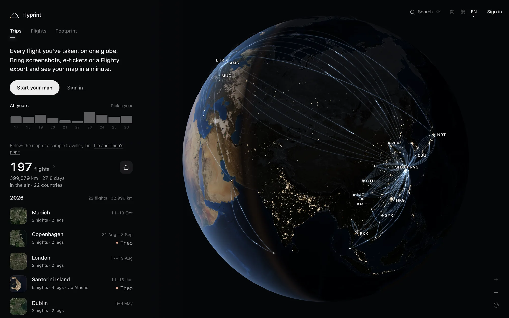
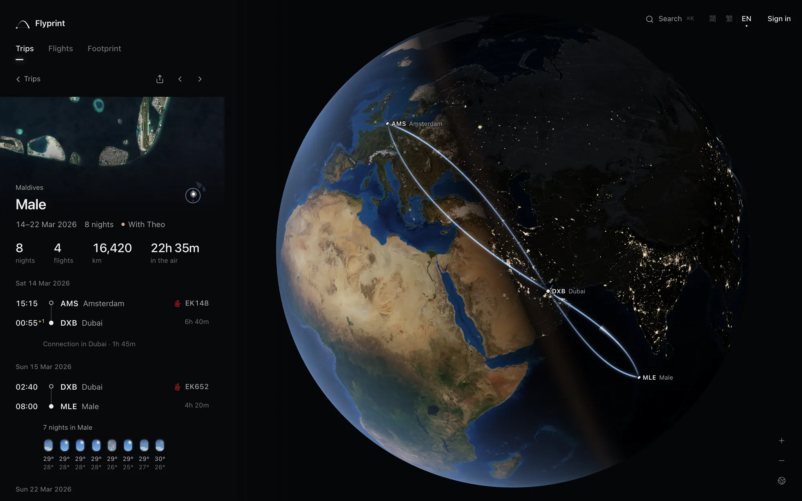
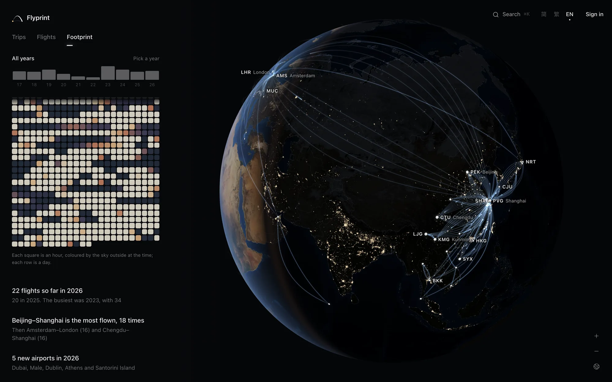
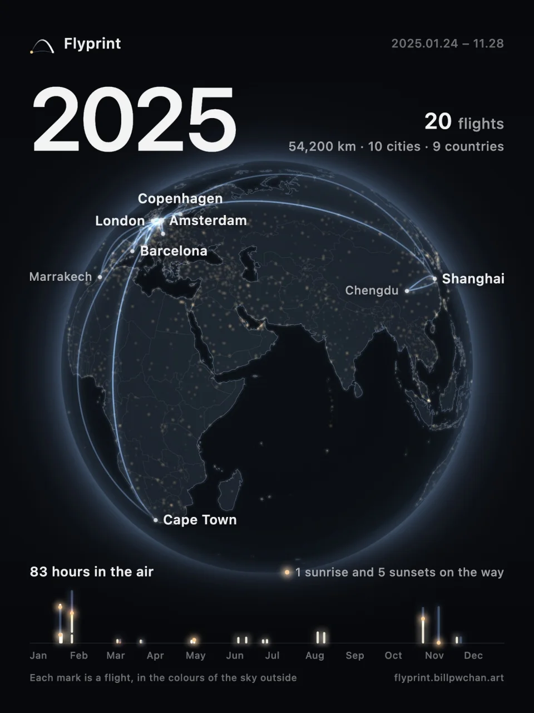
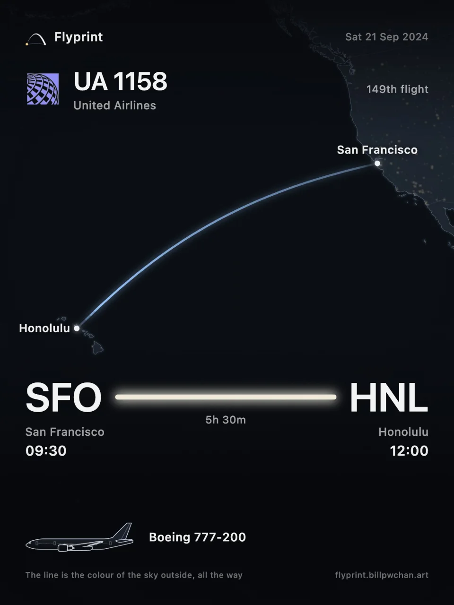

<div align="center">
  <h1>Flyprint</h1>
  <p><strong>Every flight you've taken, on one globe.</strong></p>
  <p>Import from anything · Trips worked out for you · Year, trip and flight cards · Two people, one map · Self-hosted</p>
  <p>
    <a href="LICENSE"></a>
    <a href="#self-host"></a>
    
    
    
  </p>
  <p><a href="https://flyprint.billpwchan.art/import?ref=gh-readme"><strong>Try it with your flights</strong></a> · <a href="https://flyprint.billpwchan.art/?ref=gh-readme">Live demo</a> · <a href="#self-host">Self-host</a> · <a href="#what-it-reads">What it reads</a> · <a href="README.zh-CN.md">简体中文</a></p>
</div>



<sub>All screenshots show the live demo. Lin and Theo are fictional travellers with 305 generated flights between 2017 and 2027.</sub>

---

Flighty is about your next flight. Airline apps know only the flights they sold you. Flyprint keeps all of them. Drop in boarding passes, e-tickets, booking emails, screenshots from any travel app, or an export from Flighty, Flightradar24 or OpenFlights. Every flight you have taken lands on one globe that stays on screen while you explore: by year, by trip, by city, by aircraft.

You can [try it on your own flights](https://flyprint.billpwchan.art/import?ref=gh-readme) without an account. Your map is drawn from the first upload; sign up to keep it, or it is deleted after 7 days.

## What you get

- **One globe, always there.** It is the Earth as photographed, NASA's Blue Marble by day and city lights by night, lit by the sun where it really is. Pick a year, open a trip or search for a flight, and the globe turns to it and draws the routes in order. It never reloads between pages.
- **Trips, worked out.** Flyprint finds where you lived in each period from where you spent your nights. It then chains flights into trips and names each one after the place you stayed longest. Moves abroad, stopovers and multi-city trips come out right.
- **Cards worth sharing.** A year, a trip or a single flight becomes a 3:4 image (1440×1920), drawn on your device. Each card shows the globe at night with real city lights and your routes. The year card also shows the colour of the sky outside the window for every hour you were in the air.
- **Two people, one map.** Link two accounts to get a page for the flights you took together. It also shows who got where first and where you will meet next.
- **Details you can look at.** These include:
  - aircraft side profiles drawn to scale;
  - real runway layouts for each airport;
  - photos of the airframe you flew, from Planespotters;
  - which side of the plane the sun rises on;
  - a satellite picture of every city you stayed in;
  - the weather on each day of a stay.
- **What's ahead, too.** Booked flights count down and say what will be a first. While you are in the air, they show an estimated position along the route.
- **Yours alone.** An account sees only its own flights. The public page is off by default. Once on, it shows only flights that landed at least three days earlier, the round trips and cities they make up, and their local times. It shows no seats, cabins, companions or aircraft registrations. Moves, flights home and open trips are not listed as trips, and the city you live in is not among its cities, though the routes themselves can still hint at it. You can export everything as JSON at any time.

The interface is in English, Simplified Chinese and Traditional Chinese, and it renders in your language from the first byte of HTML.

<table>
  <tr>
    <td width="50%"></td>
    <td width="50%"></td>
  </tr>
  <tr>
    <td align="center"><strong>A trip</strong><br />Every leg, connection and night away, with the weather on each day.</td>
    <td align="center"><strong>Footprint</strong><br />Every hour aloft, coloured by the sky outside. Further down: the distance, the cities and every aircraft type drawn to scale.</td>
  </tr>
</table>

<p align="center">
  
  &nbsp;
  
</p>

<a id="what-it-reads"></a>
## What it reads

| Source | How |
| :--- | :--- |
| Flighty, Flightradar24 and OpenFlights exports, and Flyprint's own | Parsed directly |
| Apple Wallet boarding passes (`.pkpass`), calendar files (`.ics`), a pasted boarding-pass barcode | IATA BCBP and iCalendar |
| Any CSV or Excel sheet | Common English and Chinese column names directly; anything else goes to Claude |
| Screenshots from airline and travel apps (Umetrip / 航旅纵横 included, long screenshots too), PDF and OFD e-tickets, booking emails | Read by Claude with structured outputs; long screenshots are cut into pieces in the browser first |

Before anything is saved, you see what was found: flights you already have, cancelled ones, ones not flown yet and ones missing a detail, drawn on the globe. Re-import a booking whenever it changes. A new time or seat updates the flight, a cancellation removes it, and a rebooking replaces it. Every import can be undone. Single flights can also be added or edited by hand.

<a id="self-host"></a>
## Self-host

```bash
curl -O https://raw.githubusercontent.com/billpwchan/flyprint/main/compose.yaml
docker compose up -d
```

Open http://localhost:3000 and create an account. The image runs on amd64 and arm64.

- **Your data** lives in the `flyprint-data` volume: one SQLite database. The server keeps a daily copy there for 7 days.
- **Screenshots and PDFs** need `ANTHROPIC_API_KEY` in a `.env` file next to `compose.yaml`. Every other format imports without it.
- **Public pages and link previews** need `FLYPRINT_ORIGIN` set to the address people use.
- **Password reset by email** turns on with `RESEND_API_KEY` and `MAIL_FROM`.

From source, with Node.js 22.13 or later:

```bash
npm ci
npm run dev:demo   # the synthetic sample at http://localhost:3000
npm run verify     # privacy scan, docs, lint, types, unit and product tests
```

The deeper guides in [`docs/`](docs/README.md) are in Chinese: [deployment](docs/DEPLOYMENT.md), [architecture](docs/ARCHITECTURE.md), [data format](docs/DATA_SCHEMA.md) and [privacy](docs/PRIVACY.md).

## Under the hood

- **One Node server.** React 19 runs on [Vinext](https://github.com/cloudflare/vinext) (Vite 8, App Router-style routes), with SQLite through `node:sqlite`. There is no separate database, queue or tile server.
- **A globe that never unmounts.** MapLibre GL 6 draws it in globe projection, with the photographed Earth shaded in one custom pass that uses the same constants as the iOS app's Metal shader. Each page only declares a scene: which flights to light up, which airports to pin, where to look. Vector tiles are cut from Natural Earth at build time and served in a few chunks through a custom protocol, so nothing is requested over open ocean and no map API key is needed.
- **Where home was.** A Viterbi pass over every night runs before any trip exists. Each night away from home costs 1 and a move costs 75, so a place becomes home only after about five months: a summer back with family stays a trip, half a year abroad does not. "Near home" means within 160 km, and a trip closes when you land near home. Cases are in [`tests/trips.test.mjs`](tests/trips.test.mjs).
- **Claude for the messy inputs.**
  - Opus reads screenshots and itineraries against a JSON schema, and Sonnet names airports and airlines in all three languages.
  - System prompts are cached.
  - Model calls are capped per user and per site each day.
  - Raw files are read in memory and dropped.
- **Cards drawn on the device.** A d3-geo vertical-perspective camera matches the iOS app's field of view, and the arcs are ported from its Metal shader. Everything is drawn on a Canvas, with no server rendering.
- **Tests against the real server.** The product suite starts the production build and checks:
  - sign-up, import, review, export, undo and account linking;
  - the first render in each language;
  - per-request CSP nonces;
  - old-URL redirects.

An iOS app (SwiftUI, Metal globe) lives in [`ios/`](ios) and talks to the same server. It is not on the App Store; build it with Xcode ([notes](docs/IOS.md), in Chinese).

## How it was made

Bill Chan built Flyprint with AI coding agents, mostly Claude Code. He set the direction and judged every screen. The agents wrote most of the code, tests and documentation.

## Privacy and limits

Screenshots, PDFs and any table Flyprint cannot parse itself go to Anthropic to be read; the import page says so before you upload. Files Flyprint reads itself (Flighty exports, calendars, boarding passes) stay on the server, except that the codes of airports and airlines it has no names for yet, with their English names from the built-in tables, go to Claude for names in three languages. No dates, flight numbers or names of people go with them. Aircraft photos load in the browser straight from Planespotters. For weather, the server asks Open-Meteo for an airport and a date, never a person. City pictures are fetched by the server from EOX once per city and kept, so EOX never sees a reader. Details are in [docs/PRIVACY.md](docs/PRIVACY.md).

Flyprint is not a live flight tracker: it has no delay alerts or gate changes. A linked page covers two people at a time. Airport and aircraft reference data are local snapshots. The globe needs a browser with WebGL.

## Contributing

Ideas, bug reports and pull requests are welcome; start with [CONTRIBUTING.md](CONTRIBUTING.md). Good first areas are new import formats (with synthetic fixtures), label placement on the globe, accessibility, and translations. Please use synthetic data in issues and screenshots, never your own flights.

If Flyprint is useful to you, a star helps other people find it.

## License

The code is under the [MIT licence](LICENSE). Airline names and marks belong to their owners; map, airport and other data sources are credited in [NOTICE](NOTICE). The Earth photographs are NASA's and in the public domain. The city satellite pictures are not part of the code: the server fetches them at run time from EOX's Sentinel-2 cloudless 2024, which is CC BY-NC-SA 4.0 and allows non-commercial use only, so a commercial deployment needs its own imagery through `FLYPRINT_IMAGERY_UPSTREAM`. The screenshots in `docs/assets` show some of those pictures and are under CC BY-NC-SA 4.0 for that reason: Sentinel-2 cloudless 2024 © EOX IT Services GmbH (contains modified Copernicus Sentinel data 2024).
