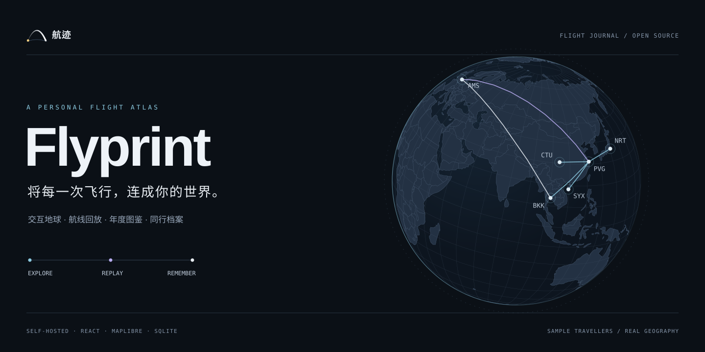
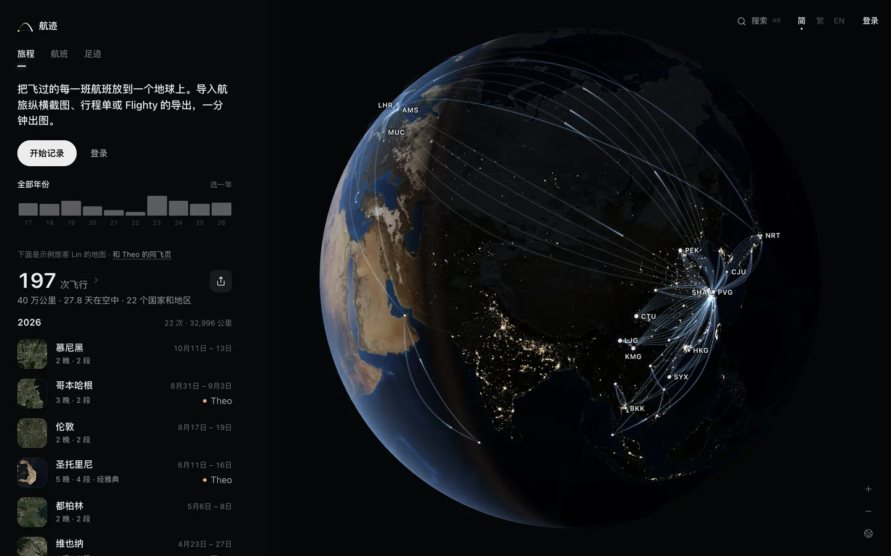
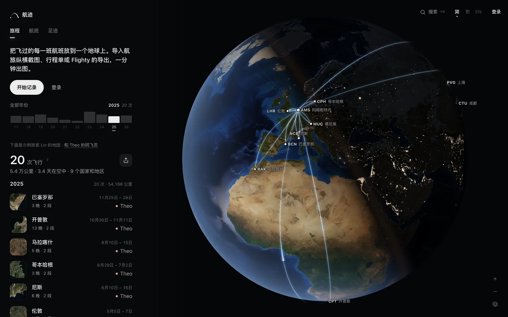
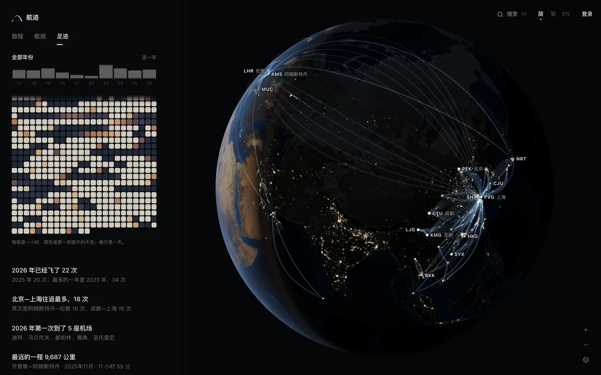
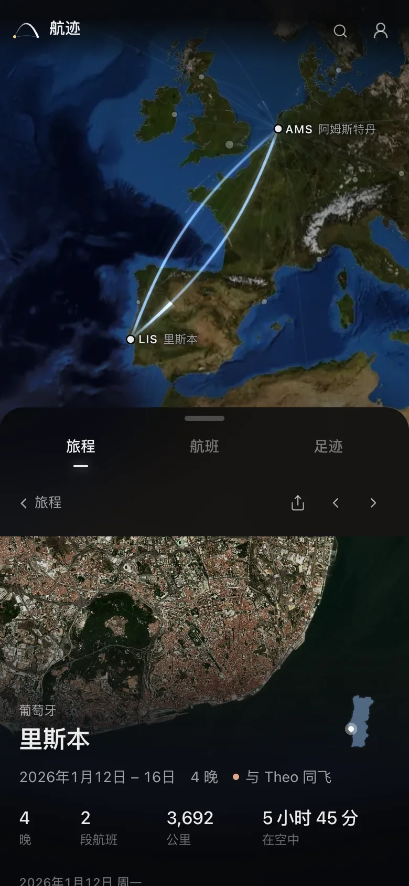

<div align="center">
  
  <h1>航迹 · Flyprint</h1>
  <p><strong>把散落的航班记录，变成可以探索、回放与珍藏的飞行档案。</strong></p>
  <p>导入任何格式 · 个人与双人旅程 · 常驻地球 · 自动推断的行程 · 分享卡片 · 自托管</p>
  <p>
    <a href="LICENSE"></a>
    <a href="docs/GETTING_STARTED.md"></a>
    <a href="docs/ARCHITECTURE.md"></a>
    
    <a href="docs/PRIVACY.md"></a>
    
  </p>
  <p><a href="https://flyprint.billpwchan.art/import?ref=gh-readme-zh"><strong>不注册，直接试</strong></a> · <a href="https://flyprint.billpwchan.art/?ref=gh-readme-zh">在线演示</a> · <a href="#preview">界面预览</a> · <a href="#self-host">自托管</a> · <a href="#quick-start">快速启动</a> · <a href="#engineering">技术亮点</a> · <a href="docs/README.md">完整文档</a> · <a href="CONTRIBUTING.md">参与贡献</a> · <a href="README.md">English</a></p>
</div>

---

一次跨洋、一段往返、两个人的同飞。航旅纵横的截图、电子行程单、Flighty 的导出、钱包里的登机牌，记下了时间和地点；航迹把它们读进来，组织成一个有地理、有顺序、有细节的交互作品。

地球铺满屏幕，一直在场：选一年、点开一次行程、搜一班航班，它都跟着转到你正在看的地方，航线从起点一段段画向终点。航段被自动串成一次次行程，以最远的过夜城市命名；每一年可以存成一张卡片，或者一段 14 秒的视频；任何一次航班、一座城市都有自己的页面。它适合喜欢记录旅行的人，也适合研究地理可视化和 React 交互的开发者。

不用注册就能[用自己的航班试一试](https://flyprint.billpwchan.art/import?ref=gh-readme-zh)：第一次上传后地图就画好了，想留下再注册，否则 7 天后删除。

<p align="center"></p>
<p align="center"><sub>一年的航班做成 14 秒的视频，在浏览器里生成，存成 MP4。图里是在线演示中示例旅客 Lin 的 2023 年。</sub></p>

> **项目状态**：可运行的自托管应用，基于 Vinext 构建。每个人注册自己的账户、导入自己的航班，每个账户只放自己的航班，两个账户联动后有一个一起看的同飞页；未登录的访客看到合成示例，也可以不注册先导入试用 7 天。截图和 PDF 由 Claude 读取，需要 Anthropic API 密钥。详见[当前边界](#boundaries)。

<a id="preview"></a>
## 看见你的飞行

下面均为应用使用**合成数据**的真实截图。航班号、日期、航司与机型组合仅用于演示。



<table>
  <tr>
    <td width="50%"></td>
    <td width="50%"></td>
  </tr>
  <tr>
    <td align="center"><strong>选一年</strong><br />这一年的旅程按时间列出，也可以存成一张卡片。</td>
    <td align="center"><strong>足迹</strong><br />在天上的每一小时按窗外天色上色；往下是绕地球几圈、去过的城市和按比例画出的机型。</td>
  </tr>
</table>

<details>
<summary>展开查看手机上的旅程页</summary>

<p align="center"></p>

</details>

### 三个部分，一条时间轴

| 部分 | 你可以做什么 | 地址 |
| :--- | :--- | :--- |
| **旅程** | 飞了多少次、多远，下一程，每一次出门按年份排列，配上目的地的卫星图；旅程页是一张带转机和停留的行程单；选一年可分享成一张图 | `/`、`/?year=2025` |
| **航班** | 按航班号、城市、航司、机型或注册号搜索全部航班，每一行下面是当时的天色 | `/log` |
| **足迹** | 绕地球几圈、在空中的每一小时、值得一说的读数、按同一比例排开的机型和航司、国家轮廓和城市卫星图；城市页画出各机场的真实跑道布局 | `/places` |

和 iOS App 一样是这三个部分。它们共用面板顶部的年份时间轴，选中的年份换部分也会保留。地球是拍出来的：白天是 NASA Blue Marble，夜里是城市灯光，太阳在它真实的位置。从这些页面可以进入旅程（`/trips/…`）、航班（`/flights/…`）、城市（`/places/TYO`）、机型（`/fleet/A359`）和航司（`/airlines/CX`）。航班页沿航线画出途中的昼夜，并告诉你日出日落在哪一侧窗外。每个页面都有可分享的地址；返回链接会写出上一屏的名字，后退时回到原来的滚动位置和年份。按 ⌘K 可以在任何页面搜索城市、旅程、航班和年份。旧版地址会永久重定向到对应的新页面。

<a id="quick-start"></a>
## 几分钟，起飞

需要 **Node.js ≥ 22.13** 和 npm，建议使用 Node.js 24。下载仓库源码并进入目录后：

```bash
npm ci
npm run dev:demo
```

打开终端打印的本地地址（通常为 `http://localhost:3000`）。演示模式强制使用合成档案，即使你的电脑已有私有数据也能安心体验。

```bash
npm run verify       # 隐私、文档、Lint、类型、单元与产品回归
npm run build:demo   # 构建合成数据版本
npm start           # 启动生产服务
```

首次安装需要访问 npm；构建字体时也可能需要网络。遇到问题先看[启动与排错](docs/GETTING_STARTED.md)。

### 导入自己的航班

注册一个账户，打开“导入航班”，把文件拖进来：

| 来源 | 怎么读 |
| :--- | :--- |
| 航旅纵横行程截图（多张、长截图）、电子行程单 PDF / OFD、订票邮件 | Claude 按结构化输出读取；长截图在浏览器里先切段 |
| Flighty、Flightradar24、OpenFlights 导出，航迹自己的导出 | 按格式直接解析 |
| Wallet 登机牌（.pkpass）、日历（.ics）、粘贴的登机牌条码 | 按 IATA BCBP 与 iCalendar 解析 |
| 任何 Excel / CSV | 中英文列名直接解析，认不出的交给 Claude |

读完先列出找到的航班：已在记录里的、已取消的、尚未出行的、缺信息需要补的各自标明，地球上同时画出这批航线。还没飞的订单可以反复导入：改了时刻或座位的原地更新，取消的移除，改签的换成新航班。核对、修改后保存，整次导入可以撤销；全部航班可以随时导出为 JSON。

订好的航班会出现在概览顶部的“下一程”，带倒计时和这一程将是第一次的事；起飞后显示飞行中与按时刻表估算的位置，降落后才计入统计。读取截图需要设置 `ANTHROPIC_API_KEY`（Docker 写在 `compose.yaml` 旁边的 `.env`，本地开发写在 `.env.local`），其余格式不需要。

<a id="engineering"></a>
## 值得打开源码的细节

### 01 · 一个常驻的地球

地球由 MapLibre GL 以 globe 投影渲染，切换页面时不卸载。每个页面只声明一个 Scene：要高亮哪些航班、钉住哪些机场、相机看向哪里。地球据此平滑移动。底图在构建时由 world-atlas 切成矢量瓦片，打包成少量分块，通过自定义协议读取，海洋上的空瓦片不会产生请求。

### 02 · 从航段推断行程

档案只记录航段。航迹先按每一晚在哪里过夜推断每段时间住在哪里（离家每晚记 1、搬一次家记 75，160 公里内算同一处，所以住满约五个月才算搬家），再按“落地城市就是下一段的出发地”把航段串成行程，以最远的过夜城市命名，并区分往返、单程与回程。

### 03 · 各自记录，同飞配对

每个账户只存自己的航班，地图、里程、年度和足迹都只算自己的。两个联动的账户各自记下同一班飞机时，同飞页按同一天、同城市航线、同航班号把它们配成一次同飞，和导入时判断重复用的是同一条规则。

### 04 · 统计写成句子

“2024 年去的新城市最多，9 座。”每条读数是一句话，附一行细节和一个小图。点一下就钉在地球上，悬停只做预览。没有数据的读数直接不出现。

### 05 · 机型信息，讲清楚知道多少

机型证据分为 `operated`（实际执飞）、`scheduled`（计划机型）、`typical`（典型参考）。注册号只接受有实际执飞依据的记录；同一架飞机坐过几次，航班页会写出来并附上链接。[证据规则](docs/AIRCRAFT_DATA.md)帮助避免把猜测呈现为事实。

### 06 · 首次 HTML 就是正确语言

简体中文、繁体中文与英语在服务端根据语言 Cookie 与请求头解析，页面标题随页面变化。产品回归在本地启动与容器相同的 Node 服务，验证三语首屏、旧地址重定向、CSP nonce，以及注册、导入、核对、导出、撤销和联动同飞的完整流程。

## 从 JSON 到你的世界


| 层次 | 技术与职责 |
| :--- | :--- |
| 应用 | React 19、TypeScript、App Router 风格的文件路由 |
| 构建与服务 | Vinext、Vite 8、独立 Node 服务输出、`node:sqlite` |
| 导入 | IATA BCBP、iCalendar、XLSX/ZIP 解析，Anthropic SDK（Claude Opus 读取、Sonnet 命名，结构化输出与提示缓存） |
| 地图 | MapLibre GL globe、构建时矢量瓦片、D3 Geo 球面几何 |
| 参考数据 | world-atlas（Natural Earth）陆地与国界，mwgg/Airports 机场与时区，OurAirports 跑道，Planespotters 飞机照片（浏览器直接引用） |
| 界面与导出 | CSS Modules、Lucide、Canvas 本地绘制分享卡片 |
| 工程检查 | ESLint、TypeScript、Node Test Runner、GitHub Actions |

源码导览、Scene 模型、行程推断规则和导航设计在[架构文档](docs/ARCHITECTURE.md)中。

<a id="boundaries"></a>
## 隐私与使用边界

每个人的航班存在服务端的 SQLite 里，登录后只看到自己的，联动的两个人另有一个同飞页；构建产物只含合成示例。截图、PDF 和陌生格式会发送给 Anthropic 的 Claude 识别，导入页在上传前写明了这一点；原始文件读完即丢弃。Flighty 导出、日历和登机牌由服务器自己解析，只有还不认识的机场和航司代码（连同内置表里的英文名）会发给 Claude 取三语名称，不带日期、航班号和任何人的名字。数据目录本身需要你妥善备份和保护，详见[隐私模型](docs/PRIVACY.md)。

航迹不做实时航班追踪（没有延误提醒和登机口变更），同飞页一次只看两个人。机场与机型参考数据是本地快照，航程使用记录值或大圆距离，不能作为运营或导航资料。地球需要支持 WebGL 的现代浏览器；升级 Vinext 后需要重新验证导航与 SSR。

`npm run privacy:check` 检查当前可发布文件，包括尚未提交的文件与常见敏感指纹；它不证明历史提交和图片内容没有隐私。公开发布前请按[干净导出与新历史](docs/RELEASING.md)检查源码；历史中曾出现的私人内容不能靠删除当前文件消除。

<a id="self-host"></a>
## 自托管

```bash
curl -O https://raw.githubusercontent.com/billpwchan/flyprint/main/compose.yaml
docker compose up -d
```

打开 http://localhost:3000 注册第一个账户。镜像支持 amd64 与 arm64（树莓派、NAS、Apple 芯片都能跑）。

- **数据**在 `flyprint-data` 卷里，是一个 SQLite 数据库；服务每天在卷里留一份副本，保留 7 天。
- **读截图和 PDF** 需要在 `compose.yaml` 旁边的 `.env` 里写上 `ANTHROPIC_API_KEY`；其他格式不需要。
- **公开主页和链接预览**需要把 `FLYPRINT_ORIGIN` 设成别人访问你的地址。
- **邮件找回密码**在设置了 `RESEND_API_KEY` 与 `MAIL_FROM` 后开启。

从源码运行：

```bash
npm run build            # 校验示例档案，再构建
FLYPRINT_DATA_DIR=/srv/flyprint npm start   # 数据库放在持久目录
```

数据目录、API 密钥、HTTPS 与 CSP、第一次启动时批量建账户的方法见[自托管指南](docs/DEPLOYMENT.md)。

## 怎么做出来的

航迹由 Bill Chan 和 AI 编程助手（主要是 Claude Code）一起完成：方向和每一屏的取舍由他决定，大部分代码、测试和文档由 AI 编写。

## 一起把它做得更好

喜欢可视化，可以改进标签布局、相机取景与地图交互；喜欢产品细节，可以完善手机交互和无障碍；喜欢数据，可以添加可复现的导入适配器。第一次贡献也可以从文档、三语文案或合成数据用例开始。

- [贡献指南](CONTRIBUTING.md)：开发流程、质量标准与适合入手的模块。
- [路线图](docs/ROADMAP.md)：已实现能力与尚待讨论的方向。
- [使用与反馈](SUPPORT.md)：排错、Bug、建议与演示作品。
- [行为准则](CODE_OF_CONDUCT.md)与[安全政策](SECURITY.md)：如何协作与私下报告风险。
- [变更记录](CHANGELOG.md)：追踪值得关注的变化。

如果这个项目对你有用，欢迎 **Star** 收藏；想关注进展，可以使用 GitHub **Watch → Custom → Releases**。分享你用合成数据做出的改进与可视化，也是帮助项目被更多人看见的好方式。

## 许可与致谢

代码采用 [MIT](LICENSE) 许可。航司名称和标识属于各自权利人；地图、机场数据与其他素材的归属见 [NOTICE](NOTICE)。地球照片来自 NASA，属于公共领域。城市卫星图不在代码里：服务器运行时向 EOX 的 Sentinel-2 cloudless 2024 现取，它按 CC BY-NC-SA 4.0 授权、只允许非商业使用，商业部署须用 `FLYPRINT_IMAGERY_UPSTREAM` 换成自己的影像。`docs/assets` 里的截图拍到了这些卫星图，因此按 CC BY-NC-SA 4.0 授权：Sentinel-2 cloudless 2024 © EOX IT Services GmbH（含经修改的 Copernicus Sentinel 2024 数据）。感谢 React、Vinext、Vite、MapLibre、D3、Natural Earth、OurAirports、mwgg/Airports、Anthropic 与所有贡献者提供的基础。

<p align="center"><sub>航迹 · 每次出发，都有坐标。</sub></p>
