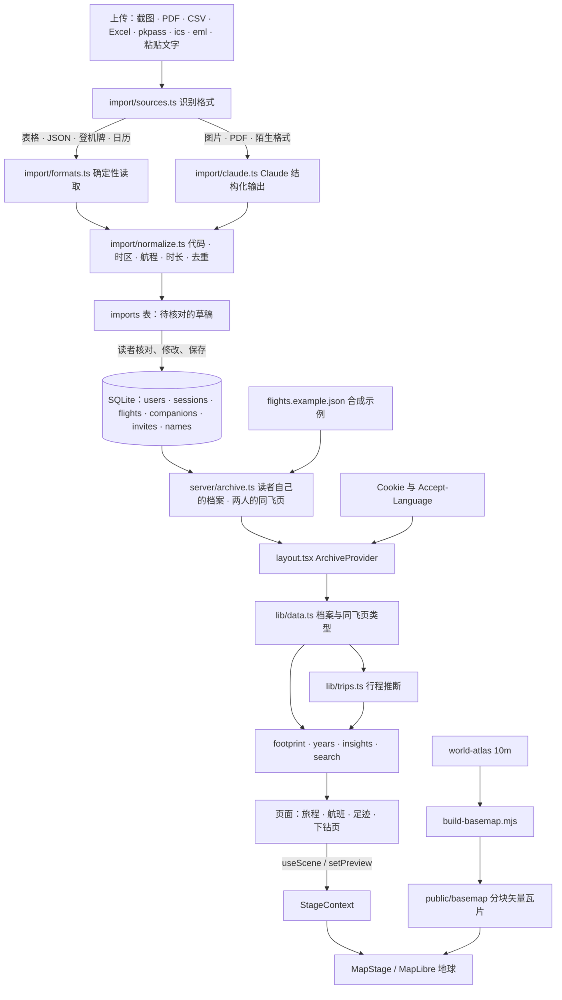

# 架构与源码导览

航迹（Flyprint）是多人使用的飞行档案。每个人注册账户，导入自己的航班（航旅纵横截图、行程单、各类 App 导出、登机牌、任意表格），每个账户只放自己的航班；两个账户可以联动，联动后多一个只属于两人的同飞页。React 负责页面、推断与文案，MapLibre GL 负责常驻地球，Node standalone 服务提供页面与 API，SQLite（`node:sqlite`）保存账户与航班。没有登录的访客看到的是合成示例档案。

## 一个舞台，多个页面

界面分两层。地球铺满整个视口，是常驻舞台，切换页面时不卸载，相机从当前位置平滑移动到下一页需要的取景。面板浮在地球上：桌面是左侧的卡片，手机是底部抽屉，停在露头、一半和全屏三档。整页从不滚动，只有面板里的列表在面板内部滚动；搜索与语言固定在顶部。

面板通过 `setInset` 报告它挡住的区域（桌面是左边宽度，手机是顶栏与抽屉露出的高度），地球把这块区域当作 MapLibre 的 padding，取景只用剩下的可见部分。抽屉换档或窗口改变大小时，地球随之重新居中。

每个页面用 `useScene` 声明地图要呈现什么（`app/components/stage/StageContext.tsx`）：

| 字段 | 含义 |
| --- | --- |
| `flights` | 当前视角的全部航班，画成淡底网络 |
| `focus` | 需要高亮的航班；为空时整张网络保持同一亮度 |
| `pinned` | 始终显示标签的机场 |
| `directed` | 是否表现飞行方向 |
| `camera` | `world`（可用 `around` 求加权中心）或 `fit`（框选点集，限制最大缩放） |
| `cameraKey` | 只有它变化时相机才移动，页面重渲染不会打断读者自己拖动的视角 |

三个部分（旅程、航班、足迹，和 App 一样）共用顶部的年份时间轴（`common/TimeBar.tsx`、`common/Lens.tsx`）。年份写在地址的 `?year=` 里：服务端按它渲染首屏，之后由 `shell/address.ts` 用 `history.replaceState` 改写地址，不经过路由往返；分区标签会带上当前年份，换分区时年份不丢。← → 在有航班的年份之间切换。

悬停列表行或读数时，页面调用 `setPreview` 临时高亮相关航班，不改变路由。预览的大部分端点在地球背面时，停留 450ms 后才转到可见面，鼠标扫过列表不会让地球乱转。地图上的机场与每一条弧线都可以悬停：机场显示到达次数，弧线显示是哪一次航班（航班号、方向、日期）和这条航线一共飞了几次，被指中的那条变亮加宽。点击机场打开城市页，点击弧线打开那次航班；手机上一次轻点挑不出扇面里的某一条，改为打开这条航线的全部航班。

## 航线与相机

航线不用 MapLibre 的线图层，而是 `stage/arcs.ts` 里的自定义 WebGL 图层，直接画在地球的单位球矩阵上。每一次航班是一条弧线，不按航线合并，所以图上能读出飞了几次、往哪个方向、和谁一起：

- 弧线在地面上向航行方向的右侧弯出（`lib/geo.ts` 的 `bowedTrack`，中点侧移为航程的一个比例），同一条航线的去程和回程因此分在两侧，合成一个透镜形。
- 同城市、同方向的航班从里往外排成扇面（`lib/network.ts` 的 `bowsOf`）：第一条侧移 7%，之后每条加 3%，最宽 26%，航班越多扇面越密。排序先按归属（自己的、两人同飞的、对方的；后两种只在同飞页出现）再按日期，所以扇面里是一条条颜色带。同一城市的几个机场（浦东与虹桥、首都与大兴）共用一个扇面，不会互相穿插。
- 弧线同时按航程离地升高（中点高度为半径的 `0.16θ/(1+0.7θ)`），在枢纽附近和地球边缘把航线分开。

弧线是发光的细线：一次绘制同时输出线芯和高斯光晕，颜色按预乘输出、部分叠加混合，重叠处越叠越亮但不会发白。弧线分三组：底网、焦点、悬停，各有一组光晕宽度、光晕强度、叠加比例和光脉冲强度（`LOOK`）。同一航线飞得越多，单条线越暗（底网按次数的 −0.42 次方、焦点按 −0.25 次方衰减），常飞航线因此是一束清晰的扇面而不是一团白光；端点附近压暗，枢纽机场不会被几十条线的起点淹没；地球在屏幕上越小，底网整体越暗（按地球半径 420px 归一）。

每条弧线上有一颗光点按航行方向循环飞过：相位由航班 id 哈希得出，彼此错开；飞完一程的时间按航程的平方根增长，长航线不会快得像流星。光点带航线本身的颜色，只在头部发白，尾巴短而锐利。光点在场时地图连续重绘；读者开启减少动态效果时没有光点。焦点出现时底网淡下去，焦点里的弧线越接近降落端越亮。行程这类按顺序的场景逐段画出，再循环一颗彗星。取景用的点（`pathPoints`）取自画出来的弧线本身，扇面不会被裁掉。

地球本身是深色海洋、略亮的陆地、一圈很淡的海岸线、每 15° 一条经纬网，机场有一层模糊光晕。

被地球挡住的部分用射线与球体求交隐藏。弧线越靠近地球轮廓越暗（底网最多暗到 45%，焦点更轻），超出轮廓的部分直接淡出，不会挂在太空里。判断用的是屏幕上相对轮廓的位置，而不是地面离地平线的角度：透视下靠近边缘的几十度只占十几个像素。拾取在 CPU 上按同样的投影计算。

相机不用 `cameraForBounds`，它在地球投影下按墨卡托估算，常常放得过大。MapLibre 的相机距离注视点 1.5 个屏幕高度（视场角 36.87°），所以地球轮廓比半径小，远离中心的地方也被缩小。`fit` 取景先求包住全部点的最小球冠，再按透视算出让球冠落在可见区域 76% 以内的缩放，并为弧线升高留出余量；球冠放不进可见半球时退回全球视角。全球视角让地球轮廓占可见区域短边的 45%（手机 47%）。减少动态效果时，相机直接跳到位，航线不做绘入和彗星动画。

## 数据流



每个请求由 `loadSession` 决定读谁的档案：有有效会话时只读这个账户自己的航班，并为每个联动标出哪些航班对方也记了（`flight.with`）；没有会话时读合成示例。同飞页由 `loadPair` 另外装配，见下面的“联动与同飞”。档案只带当前页面需要的机场、航司和国家名（`gazetteer.ts` 从内置机场表、精选三语名和导入时学到的名字里取；人人都能查的机场搜索只用内置名字），随服务端渲染一起下发，浏览器端用 `registerAtlas` 登记。

### 账户

密码用 scrypt 加盐散列。会话是随机令牌，数据库只存它的 SHA-256；Cookie `waypoint_session`（沿用改名前的名字，改了会让所有人掉线）为 HttpOnly、SameSite=Lax，HTTPS 下带 Secure，有效 180 天。所有写操作检查 Origin 与 `Sec-Fetch-Site`，拒绝跨站请求。登录在核对密码之前就计一次尝试（并行的猜测也算），同一邮箱在同一网络 15 分钟内 8 次、同一网络 30 次后暂停，别人在别处猜你的密码不会把你锁在外面；注册每个网络每小时 10 次；改密码和删除账户同样限次。网络地址取自站点自己的反向代理追加的最后一个 `X-Forwarded-For`。改密码会结束其他设备上的会话。删除账户会连带删除航班、导入记录、会话、联动和邀请链接。

**试用**：访客第一次写入（`POST /api/imports` 或 `POST /api/flights`，`signedIn` 的 `trial` 选项）时建一个试用账户（`users.guest = 1`，没有密码，邮箱栏是 `<id>@guest.invalid` 占位）和 7 天的会话；写入失败就连账户一起删掉，每个网络每小时最多 10 个。试用账户和普通账户走同一套页面，只是不能打开公开主页、不能联动，设置页送去注册。注册时 `keepGuest` 给同一个账户补上邮箱、密码和名字，换成普通会话；登录已有账户时 `absorbGuest` 把航班并进去（确定重复的跳过），再删掉试用账户；结束试用（退出）立即删除。建立 7 天后未保留的试用账户每小时清理一次，航班、导入和会话随之删除。带来源的访客开始试用时 `arrivals.trials` 加一。

### 联动与同飞

每个账户只放自己的航班。两个账户联动后，多出一个只属于他们两人的同飞页 `/with/<对方 id>`，其余页面仍然只有自己的航班。

- **联动**：一方在设置里填对方注册用的邮箱，对方在设置里接受；或者复制一条邀请链接 `/join/<token>` 发给对方，对方登录或注册后接受。邀请链接 7 天内有效、只能用一次，新建一条会让旧的失效，数据库只存它的 SHA-256。两人互相发邮箱邀请等于接受。一个账户最多 20 个联动与未答复的邀请。任一方可以解除，两边的联动一起删除，航班不受影响。
- **同飞**：同一天、同一城市航线、同一航班号（或一方没有航班号），和导入去重的“确定重复”是同一条规则（`records.ts` 的 `sameFlight`）；对方的每条航班最多配对一次。两个人各自保留自己的那条记录，不合并存储。
- **共享范围**：`companions.shares` 记下每一方让对方看到什么。默认 `together`，只有两人都记了的航班；改成 `all` 不会单方面生效，只有双方都是 `all` 时，同飞页才能在地球上叠加各自的其他航线，并比较谁先到过哪座城市。对方的航班只带日期、时刻、航线和航班号，不带座位、舱位与机型。重新联动时回到 `together`。
- **访问**：同飞页只在两个账户已联动时打开，其他账户看到“没有这个联动”，未登录访客被送去登录；示例 `/with/sample` 例外。
- **颜色**：每个账户有一个航线颜色（`users.tone`，6 种里选一种，注册时轮流分配，设置里可以改）。同飞页上自己、对方各用自己的颜色，同飞的航班用暖金色；两人颜色相同时，对方换成下一种。

### 导入

`POST /api/imports` 接收最多 40 个文件（单个 15 MB，总共 80 MB）和一段粘贴文字，建一条导入记录后立即返回，读取在后台进行，页面每秒询问一次进度。请求必须声明 `Content-Length`；同一账户同时只能有一次上传，全站同时最多两次，避免内存被几次大上传占满。服务重启时，被打断的导入标为失败，不会一直占着“读取中”。

1. **识别格式**（`sources.ts`）：按文件头和扩展名分出表格（CSV、TSV、Excel）、JSON、文本（含 HTML、邮件、OFD 里的文字）、图片、PDF 和 Wallet 登机牌。文字编码自动识别 UTF-8、UTF-16 与 GB18030。所有解析都是一遍扫描，并设了上限：文字 200 万字、JSON 200 万字、表格 2 万行 256 列且最多 20 万格、压缩包总共解压 48 MB 且条目不能共用数据、图片 5 MB、PDF 8 MB。每个文件读完立刻变成航班或待识别的任务，内存里同时只有一个解析中的文件；全站同时最多两次导入在解析。特制的小文件不能把服务拖死或撑爆内存。
2. **确定性读取**（`formats.ts`）：Flighty、Flightradar24、OpenFlights 的导出，中英文列名的表格，航迹自己导出的 JSON（`format` 为 `flyprint`，改名前为 `waypoint`），登机牌条码（BCBP，粘贴文字里的条码也能认出）和日历事件，不经过模型。航旅纵横的长截图在浏览器里先切成有重叠的几段再上传。
3. **模型读取**（`claude.ts`）：图片每 4 张、PDF 每份、长文字每 6 万字、陌生表格每 120 行一批，交给 Claude（`claude-opus-5-5`），用 JSON Schema 约束输出，最多 30 批、3 批并行。系统提示开启提示缓存。每个账户每天最多 60 次调用，全站 600 次；试用账户每个 20 次，所有试用合计 300 次，用完时提示注册后可以接着导入，有账户的人总有另一半。
4. **命名**：内置表里没有的机场和航司，由 `claude-sonnet-5-5` 给出简体、繁体、英文名，以及 ICAO 航司代码对应的 IATA 代码，写入 `names` 表供以后复用。常见航司的 ICAO→IATA 对照内置在 `designators.ts`，没有模型时也能把 Flighty 的 `CPA 255` 写成 `CX255`。
5. **规整与核对**（`normalize.ts`）：统一机场与航班号，按机场时区算出飞行时长和跨日，没有时刻时按距离估算并标明；找出缺日期、认不出机场、起降同一机场等必须修正的问题，以及与已有记录重复、已取消、尚未出行的航班。同一航班出现在多个来源里只保留一条。

读者在核对页勾选、修改后保存，航班带上这次导入的 id 写入 `flights` 表；撤销导入按这个 id 删除。原始文件只在内存里读取，不写盘。

### 手动添加与修改

`POST /api/flights` 添加一段，`PATCH /api/flights/:id` 修改，`DELETE /api/flights/:id` 删除，都只作用于登录者自己的航班（别人的 id 一律 404）。添加和修改走导入同一套规整（`edits.ts` 调 `normalize`），时长、跨日、距离和重复的判断与导入一致；修改时把这条自己排除在重复判断之外。先查字段（日期、机场、时刻、航班号写法、机型、注册号），最后才查是否与另一条重复（409，并给出那条的 id）。

- **机场**（`airportSearch.ts`）：`GET /api/airports?q=` 按代码、ICAO、城市名、机场名（简、繁、英）给出候选，公开、可缓存。保存时只在答案唯一时替读者决定：大写的代码（HKG、VHHH）；不和任何地名重名的小写代码（hkg）；全世界只有一个客运机场叫这个全名、也没有别的机场名字以它开头（希思罗、Heathrow、浦东、香港）；或者只出现在一个机场名字里的一段，而这一段有意义（名字开头、汉字、五个字母以上）。多机场城市（伦敦、上海、马德里）、几国同名的城市（Santiago、Lima）、和代码同形的城市（小写的 nan）返回 `origin_ambiguous` / `destination_ambiguous`，由读者从候选里选：是哪个机场本身就是记录的一部分。空军基地和直升机场不参与按名字决定。机场表把一些城市写成当地语言（Venezia、Napoli、Tokoname），`EXONYMS` 补上英文名和表里缺的机场名（羽田、伊丹）。表单在离开输入框时把决定了的名字换成代码，保存前看得到；输入框不强制大写。
- **机型**：表单带着已记的机型和注册号，提交回来的就是全部事实：留空表示没有机型；机型名和已记的一样时保留它的来源，只换注册号；新写的机型按导入的规则识别，认不出返回 `aircraft`；只写注册号不写机型返回 `registration_type`。
- 改了日期、航班号或航线，代码共享的实际承运航班清空；手动修改过的航班不再属于原来那次导入，撤销导入时不会把它删掉。导入时留下的、和航线对不上的时刻，只要这次没改时刻，不挡住其他字段的修改。

### 去重

大家通常每次都上传到目前为止的全部记录，所以“同一次飞行绝不写两次”由一条规则（`normalize.ts` 的 `matchOf`）在三处把关：读完时、读者每次修改核对时（整份草稿都和当时的记录重新比对，期间别的导入保存过也算在内），以及保存那一刻在同一个数据库事务里再查一遍。

- **确定重复**：同一天、同一航线（按城市比，PEK 与 PKX 算同一处）、同一航班号，或者有一方没有航班号。航班号先统一成 IATA 写法，去掉空格和前导零，ICAO 航司代码按对照表换成 IATA。确定重复的航班不会被写入，即使勾选了也不会。
- **可能重复**：同一天同航线但航班号不同（代码共享或改签）、同一天同航班号但航线不同（认错机场或经停航班的第二段）、同航班同航线但日期差一天（不同来源按不同时区记日期）。默认不勾选，标明“可能已在记录里”，由读者确认。
- 同一次导入里多个来源读到的同一航班合并成一行；已取消的预订不会和改签后实际飞的航班合并。
- **订单变更**：还没落地的航班（按两端机场时区算出的落地时刻晚于现在，`landing.ts`）确定重复、且航班号相同时，比对时刻、座位与舱位，有不同就成为“有变更”，保存时原地更新那条记录，不新增；来源说已取消的，成为“已取消，会移除”，保存时删除。没有航班号可比的只当作重复或已取消，由读者处理。改签的两种情况由 `settle` 收尾：同一班仍在的，取消让位于更新；改到另一班的，新航班从“可能重复”转为新增；同一条记录只接受一处变更。
- **只做读者看到的**：每次核对与保存都带上读者看到的状态（`seen`）。刚变成重复或已取消的行取消勾选；保存时如果有勾选的行状态变了（别的导入先保存了、航班已经落地），什么都不写，把新状态交回页面再看一遍。
- **撤销**：更新前后的字段与被删的整条记录存进导入记录（`imports.sources` 的 `$.undo`）。撤销时只改回仍是这次写入的字段（时刻、时长、来源作为一组，座位、舱位各自一组）；被之后的导入又改过的部分保留，并把原值交给那次导入，之后撤销它也能回到最初。被删的航班放回，除非加入它的那次导入已经撤销，或同一航班已经又在记录里。

### 公开主页

`users.share` 是一个随机链接名（31 个不易认错的字符取 16 位），默认为空。`/s/<链接>` 由 `sharedArchive` 装配：只取落地已满 3 天的航班（只有这些不带落地时刻），去掉起飞时刻、注册号、实际承运、座位与舱位，不带 `with` 与联动，航班 id 加 `s:` 前缀，避免与读者自己的航班撞名。页面在根布局的档案之内再套一层 `ArchiveProvider`（带 `shared`），复用概览；场景带主人的航线颜色并设为只读，点击航线与机场不会跳到读者自己的页面。分区标签在公开主页上隐藏。

预览图 `/api/share/<链接>/image` 由 `shareImage.ts` 用 d3-geo 生成 SVG、sharp 转为 1200×630 PNG：地球能装下全部航线时用正射投影，否则用 Equal Earth；图里不放文字（容器里没有中文字体），标题和描述写在页面元数据里。按航线内容的散列缓存，航线一变就重画，页面元数据里的图片地址也带上这个散列。站点自己的预览图 `/api/og` 用示例旅客按同样方式绘制。关闭分享会把 `share` 置空，旧链接与预览图随即 404；再打开生成新的链接名。

### 找回密码

只有设置了 `RESEND_API_KEY`、`MAIL_FROM` 与 `FLYPRINT_ORIGIN` 时才出现。申请时无论邮箱是否注册都返回同样的结果，发信不等待，响应时间也一样；同一邮箱每小时 3 次、同一网络 10 次。链接里的令牌 32 字节随机，数据库只存其 SHA-256，1 小时有效、用一次即删除该账户的全部令牌；过期的令牌只删除它自己，不影响更新的那封邮件。设好新密码后结束该账户全部会话，并在当前浏览器登录。邮件里的地址取自 `FLYPRINT_ORIGIN`。

### 备份

数据库打开一分钟后在数据目录的 `backups/` 里写当天的 `VACUUM INTO` 副本（先写 `.partial` 再改名），之后每小时检查一次，只保留最近 7 份 `waypoint-YYYY-MM-DD.db`（数据库文件沿用改名前的 `waypoint.db`）。副本与数据库在同一个卷上，能挽回误操作和坏迁移，挡不住整卷丢失；需要异地副本时另行复制。

### 即将出行

档案里有还没飞的航班。服务端给每条落地在三天内或之后的航班算出起飞与落地的时刻（`departAt`、`arriveAt`，按两端机场时区；只有日期的按当天结束），档案带上读取那一刻 `asOf`。`ArchiveProvider` 按一个只在有航班落地时才前进的时刻把档案分成 `flights`（已落地，所有统计、地图与列表读它）、`ahead`（订好的与飞行中的，最早的在前）和 `all`；下一次落地时自动重新分，页面不必刷新。倒计时用 `useClock`：首次渲染用 `asOf` 和 Cookie `waypoint-zone` 里读者上次所在的时区，服务端与浏览器写出同样的字，之后换成浏览器自己的时钟，每 15 秒更新。

- 地球上订好的航线画成虚线；飞行中的那一段按时刻表估算的进度分成实线与虚线，当前位置是一个随地球移动的点。
- 航班页的日出日落用 `daylight.ts` 沿大圆航线逐点算太阳高度，再按机身宽窄把左右侧换成座位字母（窄体 A/F，宽体 A/K）。
- 同飞页的“下次见面”（`plan.ts` 的 `nextTogether`）：两人都订了的同一班，或各自落地同一座城市、停留时间重叠，且那里不是任一方当年的常驻地。

## 目录导览

```text
app/
  page.tsx                  旅程：飞了多少、下一程、全部旅程；?year= 那一年；可分享成一张图
  trips/[id]/               单次旅程（/trips 永久跳到 /）
  places/ places/[id]/      足迹（含机型与航司）与城市页；id 是都市区代码，如 LON、TYO；城市页带各机场跑道图
  fleet/[icao]/             单个机型页（/fleet 永久跳到 /places）
  airlines/[code]/          单个航司页
  log/                      全部航班与搜索，查询写在 ?q=
  flights/[id]/             单次航班：沿途昼夜光带、机型侧视图、这架飞机的照片
  login/ signup/            登录与注册
  import/                   导入、核对与撤销；?id= 指向一次导入
  settings/                 名字与航线颜色、联动、导入记录、导出、密码与删除账户
  with/[id]/                两个联动账户的同飞页
  join/[token]/             邀请链接
  api/                      auth · account · links · imports · flights · export · weather · imagery（城市卫星图）
  components/
    shell/                  框架、账户菜单、手机抽屉、⌘K 搜索面板、地址参数、导航栈与滚动记忆
    account/                登录注册、导入与账户设置
    stage/                  Scene 模型、MapLibre 地球、拍出来的地球图层（earth.ts）、航线图层
    common/                 年份时间轴、读数、柱列、旅程行、城市卫星图与页头、航司底色、详情页头、返回链接
    pair/                   同飞页：读数、一起的行程、共享与解除
    aircraft/               机型侧视图、Planespotters 飞机照片
    fleet/                  机型与航司页，足迹里的机型阵列与航司列表
    cards/                  分享卡片：地球静帧、三张卡的排版、预览与分享
    shared/                 公开主页 /s/：给收到链接的人看的旅程、距离、国家与城市
    places/                 足迹（距离、空中的小时、国家、城市、读数）与城市页
    trips/ log/ trip/ flight/
  lib/
    data.ts                 档案、联动与同飞页类型
    trips.ts                行程推断
    footprint.ts            城市、国家与城市间连接
    years.ts insights.ts    年度报告与首页读数
    search.ts               三语、忽略重音与空格的航班和城市搜索；链接用 type:A320、airline:CA、route:SHA/HKG 做精确筛选
    places.ts               都市区、三语国家名与城市名
    network.ts geo.ts       地图要素与球面几何
    basemap.ts              底图分块的自定义协议
    copy.ts                 三语界面文案与格式化
    request.ts              服务端语言解析与页面标题
    copy-account.ts         账户、导入与设置的三语文案
    copy-fleet.ts           机队、机型与航司的三语文案
    aircraft/               机型侧视图（实测轮廓的参数模板）与机型目录
    fleet.ts                按机型、航司、注册号与航线汇总
    daylight.ts             太阳位置与沿航线的昼夜
    runways.ts              跑道数据的类型
    server/                 数据库、账户、会话、联动、档案与同飞页装配、机场、跑道与名称表
    server/import/          格式识别、确定性读取、Claude 读取、规整与核对
scripts/                    数据、底图、素材、隐私、文档与导出工具
tests/                      仓库工具与生产服务回归
deploy/lightsail/           独立 Node 容器与 HTTPS 示例
```

旧版地址（`/journeys`、`/atlas`、`/insights`、`/flights`、`/together`、`/global`、`/experience`、`/years`）在 `next.config.ts` 中永久重定向到对应的新页面，`/years/2025` 跳到 `/?year=2025`。

## 行程推断

档案只记录航段。行程推断分两步：先求每个时刻住在哪里（`residence.ts`），再按居所把航段串成行程（`trips.ts`）。

- 居所按“夜晚在哪里过”求，而不是哪个机场经过得最多。两段航班之间，人在前一段落地的地方，只要下一段从那里或附近出发（160 km 以内算一个可居住的地方，如香港与深圳）。每个时刻的家是能解释最多夜晚的地方：离家过一夜记 1，搬一次家记 75 晚，用动态规划在整段历史上取总代价最小的居所序列。所以一个暑假回家仍是一次行程，半年以上在外才成为新家，搬家落在实际搬过去的那一班上。两个相距很远的机场之间沉默超过 120 晚，说明记录有缺口，不算在任何地方过夜。
- 行程从家出发，回到家（原来的家或新家）、或者记录出现缺口（相距很远的两段之间超过 30 晚）时结束。
- 两段之间按地面时间分为转机、停留与陆路：12 小时以内、且不是原路折返的是转机；超过 12 小时（在城市里过了一夜）或当天折返的是停留；下一段从另一座城市出发的是陆路。
- 行程分为往返（从家出发再回家）、搬家（从一个家到下一个家）、去程（出去了没有回程记录）、回程（只记了回家那一段）和单程（两端都不在家，比如首尾走的是陆路）。回程不算一次出行，首页和城市页不把它当作目的地。
- 行程以离家最远的停留城市命名。曾经是家的地方之后再去也算出行。
行程 id 是首个航段的 id；旧版带视角前缀的链接（如 `BZ-B-F015`）仍然能打开。

## 导航与滚动

`shell/navigation.ts` 维护应用内的导航栈。返回链接显示上一屏的名字（例如“足迹 · 2025”或某次旅程），点击时执行真正的浏览器后退。桌面和手机上滚动的都只是面板里的列表（`[data-scroll-root]`），每个路径的位置单独记录。前进到新页面时从顶部开始，后退时回到离开时的位置；新页面从前进或后退的一侧滑入。再点一次当前分区的标签会回到顶部，在航班页还会清空搜索。

手机抽屉的拖动只认抽屉头部和列表：从头部可以任意拖；从列表向上拖时先抬高抽屉，到全屏后才滚动列表，在列表顶部向下拖时放下抽屉。松手后按速度预测落点，吸附到最近的一档。浏览器会把落在把手附近的触摸吸附到分区标签上，所以按下时不判断目标，移动超过 6px 才算拖动，并拦掉随后那次点击。

后退时，新页面可能在 `popstate` 送达任何监听器之前就已挂载。Navigation API 的 `navigate` 事件来得更早，所以导航栈在捕获阶段监听它，记下这次后退要落到的路径；新页面挂载时路径相符，才按后退处理。普通导航会清掉这条记录，所以只改查询串的后退不会影响下一次前进。浏览器不支持 Navigation API 时，退回到在捕获阶段监听 `popstate`。记录页的搜索框直接跟随地址栏，不依赖路由的 search params。

## 底图与分享卡片

`build-basemap.mjs` 把 world-atlas 的 10m 陆地与国界切成 z0–7 的矢量瓦片，再按 z3 打包成少量分块，写入 `public/basemap/`。客户端通过 `flyprint-basemap://` 自定义协议读取分块，海洋上的空瓦片不会发出网络请求。改动瓦片参数时，同步修改脚本和 `lib/basemap.ts` 中的版本号。

分享卡片（设计见[设计原则](DESIGN.md#分享卡片)）在 `components/cards/`：`globe.ts` 画地球静帧，`cards.ts` 排年份、行程、航班三张卡，`ShareCard.tsx` 是按钮和预览。画布是 360×480 点，按 4 倍绘制成 1440×1920 的 JPEG，在浏览器本地完成。地球用竖直透视投影（d3 `geoProjection` 自定义，视角 22°，看向球心，北朝上），和 iOS `GlobePrinter` 是同一台相机，取景逐行对应 `GlobeStill.framing`，航线亮度对应 `Globe.metal` 的航线着色器，排版点位对应 `Cards.swift`，所以同一次行程在两端出的图一样；改一边要同步改另一边。

陆地、海岸和国界来自 world-atlas 50m；机场灯光来自 `components/cards/lights.json`，由 `scripts/build-lights.mjs` 从 `lib/server/runways.json` 生成（最长跑道 1,200 米以上的机场，按长度分四档），跑道数据更新后运行 `npm run lights`。这两份数据在第一次分享时才加载。光晕不用 `ctx.filter`（Safari 不支持）：航线先全部画进一层，再取这一层的阴影；天色柱的多色光晕用逐级缩小再放大的模糊。用完的画布立即把尺寸置零，iOS Safari 对一页所有画布的内存有上限。

年份短片走同一套绘制：`timeline.ts` 是纯函数的时间表（每班何时起飞、落地，全片多长，测试在 `tests/film.test.mjs`），`cards.ts` 的 `yearFilm` 按时间画任意一帧，`film.ts` 按 3 倍画到 1080×1440 的画布上，逐帧交给 WebCodecs 的 `VideoEncoder` 编成 H.264，再用 mp4-muxer 封装成 MP4。不变的部分只画一次：地球底图、完成的整张卡（片头、片尾和最后的停留都直接贴它，所以最后一帧就是图片的同一次绘制，只是按 3 倍）、已经落定的航线和它们的光、已亮的机场和城市名、日历上已长满的柱；每帧只画还在动的航线（只在它们的范围内取光晕）、正在亮起的点和字、正在长的柱和数字。航线落定时整层光要重算一次，航班密时攒几帧一起算。编码队列超过 4 帧就等，等到编码器取走一帧、过了 50 毫秒或生成被取消为止，帧之间让出主线程，预览才能显示进度。浏览器不支持 H.264 编码时 `filmSupport()` 返回空，界面不出现视频选项。生成的视频用 `blob:` 地址播放，所以 CSP 要有 `media-src 'self' blob:`。

## 数据真实性

每条航班只属于记下它的账户；两个人同飞是两个账户各有一条，同飞页按同一条规则配对，不合并存储。机型信息用 `operated`、`scheduled`、`typical` 区分证据等级，航班页如实标注。详细规则见[机型证据](AIRCRAFT_DATA.md)。

服务端渲染的文字不依赖运行时的 ICU 数据：国家名、日期和排序的平局都在代码里写定（Node 的地区名是“中国香港特别行政区”，Chrome 是“香港”；中文 `localeCompare` 在两边的排序也不同），否则首屏 hydration 会对不上。

## 构建与检查

开发、测试和生产都运行在 Node 上：`vite.config.ts` 只启用 Vinext，没有 Workers 目标。构建产出服务端、客户端和 `dist/standalone/`，容器直接运行 `server.js`。

`npm run verify` 依次执行：隐私检查 → 本地文档链接 → ESLint → TypeScript → 工具回归 → 航司素材 → 生产构建 → 生产服务回归。服务回归在本地端口启动与容器相同的 Node 服务，各用一个临时空数据库：页面部分检查标题、三语首屏、示例同飞页与未登录时的跳转、旧地址重定向、CSP nonce，以及 client chunk 中是否出现 Vinext 曾经有问题的动态导航导入；账户部分检查注册登录与跨站拒绝、导入 Flighty 导出与日历并核对、保存、导出、重复识别与撤销、联动（邮箱邀请、各自航班不互通、同飞计数、双方都打开才叠加、解除、邀请链接只能用一次）、改密码与删除账户。测试不调用模型。这些检查不能代替真实浏览器里的交互和视觉验证。
